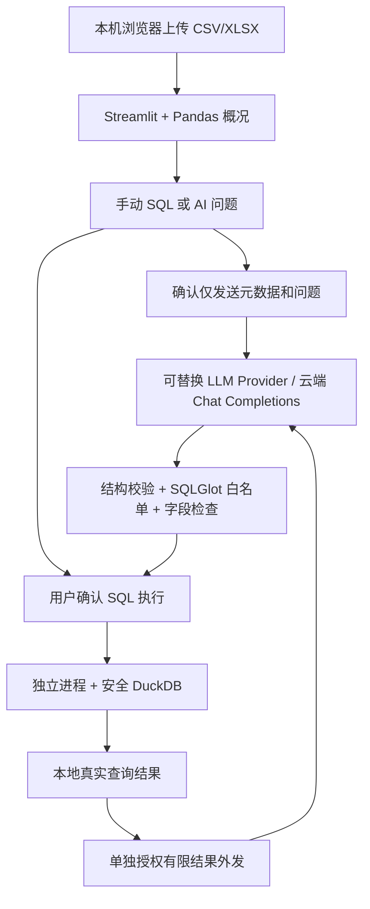

# DataPilot V4.1

V4.1 是安全与稳定性维护版：修复空结果步骤的报告覆盖声明、非标量单元格与精确
Decimal 编码、过期会话取消异常，以及过期计划拒绝事件。SQL 白名单、独立进程、
逐步人工审批、共享预算和四层授权保持不变，没有新增自动执行或模型工具能力。
Agent 外发报告仍最多 **20个结果单元格（4列长表）、8KB**，没有扩大外发范围。
修复、离线回归和剩余风险见 [V4.1 安全维护说明](docs/V4_1_SECURITY.md)。
V4.1 完整离线验收：**235 passed、0 failed、2 skipped、215 subtests passed**；
新增28项测试，2项真实API测试继续跳过，本轮未调用真实模型。

以下 V4.0.1 及更早版本内容保留为能力说明与历史验收记录，以 V4.1 说明为准。

V4.0.1 完成离线计算核对、SQL/计划审批绑定加固及确定性报告排版。摘要保留来源
步骤、原字段名、NULL和显示约数，完整结果表与审计保留；旧缓存报告也可本地重排，
不额外调用模型。详情与既有真实验收记录见 [V4.0.1验收说明](docs/V4_0_1_ACCEPTANCE.md)。
V4.0.1完整离线 pytest：207通过、0失败、2项真实 API 测试跳过，合计209项。

以下 V4.0 Beta、Alpha 及 V3.1 内容保留为原有能力和验收历史记录。

已增量加入 **V4.0 Beta Agent 页面**：打开“AI Agent 多步骤分析”，可规划最多三个
步骤，逐条审核 SQL，查看本地事实报告，并另行授权有限结果的模型报告。复用原有
DeepSeek Provider、SQL 安全执行器和共享请求预算，保留单次自然语言 SQL 功能。
本轮仅完成 Mock 验收，真实 API 端到端测试等待用户确认。
详见 [Beta 使用与验收](docs/AGENT_BETA.md)及 [Alpha 架构](docs/AGENT_ALPHA.md)。

两步骤诊断修复：Agent 现在展示失败步骤、阶段、安全类别、执行器提交状态及本次
模型请求消耗；明确要求两步而返回三步时拒绝整份计划。CASE WHEN/NULLIF 仍不
开放，零工时加权时薪沿用聚合 LEFT JOIN 方案。详情见 Beta 文档末尾诊断说明。
本次诊断修复全量 pytest：183项通过、2项真实 API 测试跳过；Agent 页面32项通过。

后续兼容修复增加了已验证的加权时薪 SQL 提示模板、安全 AST 节点/原因审计和
解析警告脱敏，未扩大白名单。实测支持范围、两步骤精确结果及离线测试入口见
[SQL AST 兼容说明](docs/SQL_AST_COMPATIBILITY.md)。
最新离线 pytest：191项通过、2项真实 API 测试跳过；运行入口为
`python scripts/run_offline_tests.py -q`，阻断真实配置默认加载和 HTTP。

Beta 验收：全量168项测试，166项通过、2项真实 API 测试跳过；新增27项页面测试
全部通过。四层授权分别为规划请求外发、完整计划、每条 SQL 执行、有限结果报告
外发，互不替代。Agent 每任务最多6次模型请求，并共享原有会话请求预算。

基于 Python、Streamlit、Pandas 和 DuckDB 的数据分析项目。支持文件上传与概况、安全只读 SQL、可选的单次 LLM 分析及受控多步骤 Agent。模型服务由用户自行配置并逐步授权；不自动启用、购买或订阅任何服务。未开发无限自主执行、图表生成或报告导出。

V3.1 完善云端接口兼容、实际 Token 用量与耗时记录、请求次数控制、模拟数据 SQL 结果评估及 GitHub 发布准备。**代码具备真实 HTTP 调用路径，但本次未开启真实云端冒烟，不能据此声称云端模型验收通过。**

默认云端配置现为 **DeepSeek 官方接口 + `deepseek-flash`**，保留 Gemini 和其他 OpenAI 兼容端点。默认选择非思考模式生成结构化 SQL；没有 API Key 时 AI 功能仍不启用。已有 `.env` 显式配置不会自动覆盖，也不会把原 Gemini 密钥转发给新的提供商；切换实际使用的服务时，请在本地同时替换密钥、Base URL 和模型。

## 功能

- 上传 CSV、XLSX 文件（单个文件最大 20 MB），Excel 可选择工作表。
- CSV 支持 UTF-8（含 BOM）、GB18030、UTF-16，以及逗号、分号、制表符、竖线分隔。
- 预览前 10、20、50、100 行；显示全部已读取数据的行数、列数、缺失值总数。
- 按字段显示名称、Pandas 数据类型、缺失值数量和缺失率。
- 对空文件、空工作表、编码不匹配、字段数量不一致、损坏或加密文件提供中文提示。
- 将当前文件或所选工作表的 DataFrame 注册为 `uploaded_data`，执行基础只读 SELECT。
- 支持 COUNT、SUM、AVG、MIN、MAX、WHERE、GROUP BY、HAVING、ORDER BY、LIMIT 等常见分析。
- 根据当前字段生成可直接载入并执行的示例查询，展示查询结果、实际返回行数和截断提示。
- 可选 AI：中文或英文问题 → 结构化 SQL 草案 → 用户确认 → 本地安全执行 → 另行授权后的有限结果解释。
- V3.1：文本分段响应、缺省结束原因兼容；显式 JSON 模式和输出上限；实际 Token 用量、耗时与会话请求预算。

## 技术架构



LLM 不持有数据库连接；它只返回待校验的结构化文本。解释请求与 SQL 生成请求使用不同提示与载荷。Provider 协议保留未来替换本地模型的空间，本次不安装或开发 Ollama。

## 项目结构

```text
DataPilot/
├── app.py                    # Streamlit 中文界面
├── src/
│   ├── __init__.py
│   ├── data_loader.py         # 文件校验、工作表选择与读取
│   ├── profiling.py           # 字段及缺失值统计
│   ├── sql_analysis.py        # SQL 解析、安全配置与独立进程执行
│   ├── process_limits.py      # 操作系统进程内存限制
│   ├── llm_provider.py        # 环境配置、可替换 Provider、兼容 HTTP 接口
│   ├── ai_analysis.py         # 元数据提示、结构校验、SQL 草案与可核验解释
│   └── ai_ui.py               # 三步确认及 Streamlit 会话状态
├── tests/
│   ├── test_data.py           # 数据读取和异常处理测试
│   ├── test_app.py            # Streamlit 界面与 SQL 交互测试
│   ├── test_sql.py            # SQL 安全、资源限制与异常恢复测试
│   ├── test_ai.py             # Mock LLM 业务、隐私限制与事实核验测试
│   ├── test_ai_ui.py          # AI 确认、状态失效、重跑与错误流程测试
│   └── test_llm_provider.py   # 配置、Mock HTTP、超时、认证和凭据保护测试
├── .streamlit/config.toml    # 本机监听、上传大小、关闭使用统计
├── requirements.txt
├── .env.example              # DeepSeek 默认配置，密钥留空；.env 不提交
├── README.md
└── .gitignore
```

V3.1 新增：`src/evaluation.py`、`examples/demo_income.csv`、`scripts/audit_release.py`、`docs/RELEASE.md`、`LICENSE`，以及 `tests/test_evaluation.py`、`test_provider_v31.py`、`test_live_api.py`、`test_release.py`。示例数据只有虚构地点代号、月份、收入和工时，无真实个人信息。

## Windows PowerShell 配置与运行

建议安装 Python 3.12（安装时勾选 Add Python to PATH），然后重新打开 PowerShell。可从 [Python 官网](https://www.python.org/downloads/windows/) 获取。先检查：

```powershell
py -3.12 --version
Set-Location .\DataPilot  # 从克隆目录的上一级进入项目；已在项目目录时跳过
py -3.12 -m venv .venv
.\.venv\Scripts\python.exe -m pip install --upgrade pip
.\.venv\Scripts\python.exe -m pip install -r requirements.txt
.\.venv\Scripts\python.exe -m streamlit run app.py
```

浏览器打开 http://127.0.0.1:8501。终端按 `Ctrl+C` 停止服务。必须在项目目录启动，以加载 `.streamlit/config.toml`。

以上命令直接调用虚拟环境，不需要激活，也不需要修改 PowerShell 执行策略。如果希望激活，可执行：

```powershell
.\.venv\Scripts\Activate.ps1
```

若被执行策略阻止，继续使用上面的直接调用命令即可。

本次开发环境没有系统 Python，测试使用 Codex 自带 Python 3.12 创建了项目 `.venv`。当前机器可直接运行上述安装和启动命令（跳过创建虚拟环境）；`.venv` 不提交到 Git，迁移后应重新创建。

## 使用说明与数据规则

1. 选择 CSV 或 XLSX 文件。
2. Excel 选择工作表；CSV 根据文件实际情况选择编码和分隔符。
3. 查看数据预览及字段统计。切换文件后重新计算，不显示旧文件统计。
4. 在“SQL 数据分析”中选择示例，点击“载入示例查询”，再点击“执行 SQL 查询”；也可以直接编辑 SQL。

查询只有点击执行后才运行。结果仅展示于本次执行，其他控件操作或文件、工作表、编码及分隔符变化会清除结果，避免旧结果与当前数据混淆。

首行固定作为表头，行数不包含表头。Pandas 自动推断数据类型，可能将带前导零的编号识别为数字；当前预览不保证原始 Excel 格式。重复或空表头可能由 Pandas 自动重命名。Excel 公式不在本应用执行，通常读取文件中已有的公式缓存值。

空单元格和 Pandas 默认缺失标记（如 `NA`、`NULL`）计入缺失值；仅有表头时保留字段、行数为 0、缺失率为 0%。纯空白字符串不一定算缺失。CSV 跳过空白行，但非空记录的字段数量必须与表头一致。

20 MB 是文件字节数限制，解压后的 XLSX 和 DataFrame 可能占用更多内存；当前适合可信的小型本地数据集，不面向公网部署。

## SQL 分析与示例

所有查询只允许访问当前 DataFrame 对应的 `uploaded_data`。通用示例：

```sql
SELECT * FROM uploaded_data LIMIT 20;
SELECT COUNT(*) AS "总行数" FROM uploaded_data;
```

包含字段的示例由界面按照当前字段名称和数值类型生成，包含分组计数、筛选非空、求和与平均。中文、空格、SQL 关键字等字段名使用双引号；字段名中已有的双引号会被转义。没有数值字段时不生成 SUM/AVG 示例。若源数据存在仅大小写不同的字段名，SQL 功能会提示先重命名，防止 DuckDB 不区分大小写造成字段混淆；原有预览不受影响。

### 安全措施

1. SQLGlot 使用 DuckDB 方言解析完整输入，只接受一条 SELECT；遍历所有子查询和表达式，采用 AST 节点与函数白名单，默认拒绝未知语法。SQL 长度最多 10000 字符、AST 最多 500 节点。解析也在查询进程内受超时和内存限制。
2. 仅允许标识符形式的 `uploaded_data`，禁止其他表、带数据库或模式的表名、任意表函数、动态查询和文件扫描。执行前重新生成 SQL、移除注释，再由 DuckDB 原生解析器验证语句数及 `StatementType.SELECT`。不使用字符串前缀判断安全性。
3. 每次查询创建全新的 `:memory:` 数据库。禁用 `enable_external_access`、扩展自动加载/安装、未签名及社区扩展、Python 变量自动替换；禁用 `LocalFileSystem`，关闭临时目录和磁盘溢写，并锁定配置。仅通过程序注册当前 DataFrame，不暴露任意 Python 对象，也不注册 Python UDF。
4. INSERT、UPDATE、DELETE、DROP、ALTER、CREATE、COPY、ATTACH、PRAGMA、SET、CALL、INSTALL、LOAD 等语句无法进入执行；SELECT 中的文件函数、网络函数、系统查询和未开放函数同样会被拒绝。没有执行用户 Python 的入口。
5. 每次使用独立的 `spawn` 工作进程，超时后强制终止并回收，不在 Streamlit 主进程中执行用户 SQL。失败后下一次查询重新创建数据库。

当前开放基础 SELECT、子查询、同表 JOIN、算术比较、IN/BETWEEN/LIKE、DISTINCT、分组、排序及分页。函数白名单为 COUNT、SUM、AVG、MIN、MAX、ROUND、ABS、LOWER、UPPER、LENGTH、COALESCE。CTE（WITH）、递归查询、UNION、窗口函数、CAST、任意用户函数和其他未开放语法暂不支持；合法但不在白名单内的 SQL 也会被拒绝。

### 默认资源限制

| 限制 | 默认值 | 行为 |
| --- | --- | --- |
| 查询时限 | 10 秒 | 包含进程启动、解析与执行等待；超时终止进程 |
| DuckDB 内存 | 128 MB | 单线程，超限报错，不溢写磁盘 |
| 查询工作进程内存 | 1024 MB | Windows Job Object 限制进程提交内存；POSIX 使用 RLIMIT_AS 限制地址空间 |
| 参与 SQL 的 DataFrame 内存 | 64 MB | 按 Pandas deep memory 估算；超限拒绝 SQL，保留预览 |
| 返回行数 | 1000 行 | 外层强制 LIMIT 1001，额外一行检测截断，仅展示前 1000 行 |
| 返回列数 | 100 列 | 超限提示用户减少字段 |
| 结果内存 | 4 MB | 获取结果后检查，超限拒绝展示 |

返回行数是实际展示的结果行数，并非被截断前的结果总行数。需要统计总量时请使用 COUNT。外层 LIMIT 不保证复杂聚合只计算少量输入，因此仍需进程超时和内存限制。限制在 `src/sql_analysis.py` 的 `QueryLimits` 中由应用定义，界面不提供扩大限制的入口。

### 安全边界与不足

- 本方案是本地应用的多层防护，不是隔离不可信代码的操作系统沙箱。SQL 解析器或数据库的原生漏洞仍可能突破应用层边界；不应直接用于公网多租户服务，也不能视为绝对安全。
- DuckDB 的 `memory_limit` 只约束部分数据库内存，所以额外设置操作系统进程限制。工作进程启动时会先导入 Python 模块和反序列化受大小限制的 DataFrame，再设置进程内存限制；用户 SQL 的解析和执行均发生在限制生效后。设置失败会拒绝查询，不降级运行。
- 超时是父进程的截止时间检查与强制终止机制，并非实时调度保证；操作系统启动、序列化、进程回收和有限大小的进程通信可能带来少量额外耗时。
- 第一阶段文件读取、Excel 解压和数据预览仍在主进程执行，未纳入 SQL 工作进程的内存及超时限制。20 MB 文件不代表解压后占用很小。多浏览器会话并发时，总内存可能为多个进程限制之和，尚无全局并发配额。
- 结果 4 MB 限制在结果生成后检查；生成期间由工作进程内存限制兜底。SQL 排序只在明确使用 ORDER BY 时有顺序保证。
- 本次操作系统限制验证在 Windows 上完成；POSIX 的地址空间限制和进程启动环境有差异，迁移后需重新验收。Windows 若现有 Job 策略阻止应用内存限制，将显示初始化失败。

设计参考：[DuckDB 安全配置](https://duckdb.org/docs/preview/operations_manual/securing_duckdb/overview)、[DuckDB 内存限制范围](https://www.duckdb.org/docs/current/operations_manual/limits)、[DuckDB Python API](https://duckdb.org/docs/stable/clients/python/reference/)、[SQLGlot AST 解析文档](https://sqlglot.com/sqlglot.html)。

## 本地数据与费用

上传、预览和手动 SQL 无须 API Key，浏览器把文件交给本机 `127.0.0.1` 的 Streamlit 服务处理。应用不将上传内容写入磁盘、不使用跨会话数据缓存、关闭使用统计且仅监听回环地址。依赖安装需要下载程序，不会发送分析文件。

AI 功能只有自行配置模型、主动勾选确认并点击对应按钮后才调用指定接口。第三方服务可能收费，也可能保存请求内容；本项目不购买服务、不检查或自动充值额度。配置与使用前请自行确认服务商的数据保留、计费和访问权限政策。

配置项参考 [Streamlit 官方配置文档](https://docs.streamlit.io/develop/api-reference/configuration/config.toml)，Excel 读取方式参考 [Pandas 官方 IO 文档](https://pandas.pydata.org/docs/user_guide/io.html)。

## 第三阶段：AI 自然语言分析

### 配置 API（可选）

已有 `.venv` 时只需更新依赖，不要重新创建项目或虚拟环境：

```powershell
Set-Location .\DataPilot  # 从克隆目录的上一级进入项目；已在项目目录时跳过
.\.venv\Scripts\python.exe -m pip install -r requirements.txt
# 仅首次配置时执行；如已有 .env，不要覆盖。
if (-not (Test-Path -LiteralPath .env)) { Copy-Item -LiteralPath .env.example -Destination .env }
notepad .env
```

在本地编辑器中填写自己的值，避免在 PowerShell 命令、截图或聊天中暴露密钥：

```dotenv
DATAPILOT_API_KEY=填写你自备的密钥
DATAPILOT_BASE_URL=https://api.deepseek.com
DATAPILOT_MODEL=deepseek-flash
DATAPILOT_TOKEN_PARAMETER=max_tokens
DATAPILOT_JSON_MODE=json_object
DATAPILOT_MAX_OUTPUT_TOKENS=1200
```

Base URL 填写 API 根路径，不包含 `/chat/completions`；程序追加该路径。远程地址必须为 HTTPS，仅 localhost、127.0.0.1、::1 允许本机 HTTP。URL 不允许内嵌用户密码、查询参数或片段。程序不自动采用系统代理或 netrc；需要代理的环境当前不支持通过代理环境变量配置。

默认 Base URL 为 `https://api.deepseek.com`、模型为 `deepseek-flash`。只填写自备的 DeepSeek Key 即可使用默认配置，但仍须经过页面确认才会调用。切换现有 Gemini 配置时，必须同时替换为 DeepSeek Key、上述 Base URL 和模型，不能继续使用 Gemini Key。现有 `.env` 不会被模板或程序覆盖。

其他提供商需要显式配置匹配的 Base URL、模型和密钥，不会从不完整的非 DeepSeek 配置猜测提供商。系统环境变量仍优先于项目 `.env`；`.env` 不向进程环境写入值，不做变量插值。`.env`、`.env.*` 被 Git 排除，唯一例外是密钥留空的 `.env.example`。页面只展示配置状态及接收方主机名，不展示密钥或 URL 路径。更改配置后建议重启应用，并检查页面接收方主机名。

DeepSeek 官方端点请求 `POST https://api.deepseek.com/chat/completions`，使用 `model=deepseek-flash`、`max_tokens=1200`、`response_format={"type":"json_object"}` 和顶层 `thinking={"type":"disabled"}`。DeepSeek 服务端默认开启思考，所以这里明确关闭；原始 HTTP JSON 不包含 SDK 专用的 `extra_body` 包裹，不发送 `reasoning_effort`。只解析最终 `message.content`，不展示或回传 `reasoning_content`。

识别官方 DeepSeek 主机时固定使用文档规定的 `max_tokens`；即使旧配置遗留 `max_completion_tokens`，也不会同时发送两个 Token 参数。其他提供商保留通用 `DATAPILOT_TOKEN_PARAMETER` 配置，未指定时仍为 `max_completion_tokens`。`DATAPILOT_MAX_OUTPUT_TOKENS` 保持 128 至 2048 的应用上限。JSON 模式提示包含 JSON 结构示例，后续严格结构校验和 SQL 安全检查不变。空白、截断、错误结构或工具调用响应均拒绝，绝不自动执行或重试。

兼容依据：[DeepSeek Chat Completions](https://api-docs.deepseek.com/api/create-chat-completion/)、[JSON Output](https://api-docs.deepseek.com/guides/json_mode/)、[Thinking Mode](https://api-docs.deepseek.com/guides/thinking_mode/)。其他兼容接口参考 [OpenAI Chat Completions 官方文档](https://developers.openai.com/api/reference/resources/chat/subresources/completions/methods/create)。不支持 `response_format` 的其他服务仍可显式设置 `DATAPILOT_JSON_MODE=prompt`，此时不发送该参数，但业务层仍要求有效 JSON。不自动降级或重试，不会为兼容探测额外产生请求。

如需继续使用 Gemini，只需在自己的 `.env` 设置 Gemini 对应密钥、`DATAPILOT_BASE_URL=https://generativelanguage.googleapis.com/v1beta/openai/`、实际可用模型 ID，并按服务兼容性选择 `DATAPILOT_TOKEN_PARAMETER=max_completion_tokens`。Gemini 格式检查仍保留，且不会接收 DeepSeek 专用 `thinking` 参数。故障状态码和安全排查说明见 [API_TROUBLESHOOTING.md](docs/API_TROUBLESHOOTING.md)。

支持标准字符串 content 与纯文本分段 content；兼容未提供 finish_reason 的有效 JSON 响应。明确的 length/tool_calls/refusal 等非正常结束、不支持的内容块、异常 JSON 和 HTTP 200 内的 error 仍拒绝处理。不会读取或展示 reasoning_content，不执行服务端工具指令。401/403、429、网络/超时和 5xx 错误都有中文提示，不显示服务端原始错误正文。

启动命令不变：

```powershell
.\.venv\Scripts\python.exe -m streamlit run app.py
```

### 三步确认流程

1. 上传文件并选择工作表，输入中文或英文问题。查看“将发送的字段与问题”预览，勾选外发确认，再点击“生成 SQL”。**字段名和问题也可能包含敏感信息**。
2. 查看生成说明与规范化 SQL，主动勾选执行确认，再点击“确认执行生成的 SQL”。只在本地复用第二阶段 `validate_sql` 与 `run_query`，原有 10 秒、行数及内存限制全部保留。执行成功后显示真实结果；失败显示中文错误，没有结果解释入口。
3. 如需模型解释，先检查实际发送的完整 JSON 预览，再单独勾选结果外发确认并点击“请求 AI 解释结果”。这一步与生成 SQL 的授权分开；不需要解释时无需再次调用 API。

页面重跑会保留草案、结果和解释，但不会自动再次请求模型或执行 SQL。数据、工作表、读取选项、问题或服务配置上下文变化时，旧分析流程失效。重新生成草案需新的执行确认；重新执行后，结果外发确认重新置为未勾选。

每个 Streamlit 会话默认最多尝试 **10 次模型请求**，生成和解释共享计数，失败也计数；达到上限后必须主动勾选费用提示并点击重置。重复主动点击仍可能收费，会话刷新/重建也可能重置计数；这不是跨会话、跨进程或服务商金额硬预算，没有自动充值、订阅或购买逻辑。

页面在调用后记录请求耗时及服务商返回的已知 Token 字段（prompt/completion/total 或 input/output）。字段缺失时保持缺失，不推算 total，不估算费用；只有有效非负整数计入显示。信息仅在当前会话保留，默认不写日志或文件。固定业务载荷与用户预览的逐字一致性已通过 Mock HTTP 集成测试核验；API Key、固定提示和模型参数属于请求控制信息，不属于数据预览中的业务载荷。

### 自然语言转 SQL 的约束

- 发送内容只有 `table`、字段 `name/dtype` 列表和 `question`，不包含文件名、原始文件、样本、数据行、总行数或缺失值统计；问题最多 2000 字符、字段最多 100 列，整个业务 JSON 最多 16 KB，另附固定系统提示。
- 输出必须是恰好包含 `sql` 与 `explanation` 的 JSON 对象；不接受 Markdown 代码围栏、额外键、重复键或非标准 JSON 常量。SQL 不可靠或能力不足时允许 `sql=null` 并请求澄清，不进入执行。
- SQL 草案先通过原有 AST 白名单，再使用 SQLGlot 的静态作用域解析检查实际字段、别名和子查询。此时不执行查询；点击确认后再次校验，再交给原有隔离执行器。不存在的字段不能成为可执行草案。类型不匹配等问题仍可能在 DuckDB 执行时发现。
- 不扩大第二阶段 SQL 白名单，不引入 LLM 工具调用、Python 执行、任意系统命令或文件访问。模型没有数据库连接或执行权限。
- “按月份统计收入和工时”需要现成的月份字段；只有日期字段时，当前安全引擎不支持日期提取函数，应提示补充月份字段。“平均时薪”需要明确是逐行时薪均值还是收入合计/工时合计，信息不足时应先澄清。
- 生成说明是模型草拟的查询思路，不是已计算的数据事实；即便 SQL 安全且字段有效，仍可能误解业务意图。请核对指标、过滤条件和聚合口径。

### 结果外发限制与事实依据

解释请求**只发送预览中的结果字段名、结果行及 `partial` 标记**；不发送原问题、SQL、原始表或文件名。默认上限如下：

| 项目 | 限制 |
| --- | --- |
| 结果行数 | 前 20 行 |
| 结果列数 | 前 20 列 |
| 单元格文本 | 前 200 字符 |
| 结果业务 JSON | 最多 8 KB（UTF-8），通过减少末尾行满足限制 |
| 模型输出 | 默认 1200 tokens，可显式设为 128–2048；HTTP 响应最多 64 KB，正文最多 12000 字符 |
| HTTP 超时 | 连接 5 秒、读取 20 秒；分块处理时检查约 30 秒截止时间，不自动重试 |

若单行或字段名本身过大，会拒绝解释而不是突破限制。安全引擎截断、外发行列省略或单元格缩短都会设置 `partial=true` 并提示：**解释只基于实际发送的部分结果，不能代表未发送的数据**。空结果或失败查询不调用解释模型。预览包不可变，业务层在发送前再次校验大小和形状。

为减少虚构，本阶段采用**受约束的中文解释**，不直接展示模型自由生成的事实段落：

- **数据事实**：模型只能选择实际单元格引用，以及指定已发送数值列的最大/最小值；应用验证行号、字段、真实值及极值，然后用本地中文模板填入真实数据。模型自行返回数值、错误字段、错误极值或自由事实文本会被拒绝。
- **模型推断边界**：仅允许固定的“不足以推断原因、因果关系或趋势”说明，不支持开放式因果或预测结论。
- **建议**：只允许核对指标定义、检查缺失值、检查完整结果等固定建议，不作为统计事实。

这是有意采取的保守范围：模型负责选择证据与提示项，本地代码负责事实表述。模型回复、字段和单元格使用纯文本显示，不渲染来自它们的 Markdown 图片或链接。

### 隐私与安全边界

- 不承诺完全防止提示词注入，也不声称 SQL 进程是完整操作系统沙箱。字段名、问题与结果内容均按不可信数据处理；提示隔离、结构校验及 SQL 白名单只是多层防护，数据库与解析库漏洞仍需关注。
- 应用不记录 API Key、HTTP 请求体、响应原文或原始异常；凭据只放入 Authorization 头，不进入提示词、页面或会话状态。若请求内容或模型正文包含当前密钥，直接拒绝发送或展示；认证失败也不显示服务端原文。请勿自行打开 HTTP 调试日志，或将带密钥的 `.env`、截图和终端记录提交到版本控制。
- HTTPS 不能消除服务商本身的数据保留风险。确认外发后，数据已离开本机；本项目无法撤回服务商收到的内容，也无法控制第三方成本或响应质量。
- API 超时采用 HTTP 连接/读取超时与分块截止检查，不是实时调度或严格端到端中断保证；慢速分块传输及服务端是否取消计费由接口实现决定。
- 本地查询限制仍不涵盖第一阶段文件解压、预览及多会话总资源。AI 草案的长度受限解析与字段静态检查也在主进程完成；真正 SQL 执行继续在隔离工作进程中完成。
- V3.1 本次仍没有使用真实 Key、没有调用真实模型或购买服务，未验证特定服务商/模型的实际兼容性；请按照下方可选冒烟流程进行用户授权验收。

## V3.1 SQL 结果评估

演示文件：[examples/demo_income.csv](examples/demo_income.csv)。可在界面上传它，无须 API 即可查看与执行 SQL。固定数据共有 8 行，收入合计 890、工时合计 22；地点均为虚构代号。

`src/evaluation.py` 定义 20 个问题：18 个查询和 2 个需要澄清的问题，覆盖 COUNT、SUM、AVG、WHERE、IN、GROUP BY、ORDER BY、月份分组、加权时薪与歧义口径。离线测试用参考 SQL 作为 Mock 输出，再经过真实白名单、字段检查和隔离 DuckDB，逐个比对**结果形状、行顺序、空值及数值**，不是只比较 SQL 文本。列别名允许不同，但结果列顺序遵循问题约定。

```powershell
.\.venv\Scripts\python.exe -m unittest discover -s tests -p test_evaluation.py -v
```

重点口径：加权时薪必须为 `SUM(income)/SUM(hours)`，不是 `AVG(income/hours)`，也不能先删除零工时记录而丢失其收入。模拟数据的 B 地点为 40.00、A 地点为 33.33，C/D 总工时为零应返回 NULL；全表比值为 40.45。

用户给出的 NULLIF 参考公式在数学口径上正确，但 `NULLIF` **仍未加入既有白名单**。本次使用 `WEIGHTED_RATE_SQL` 的聚合子查询 + LEFT JOIN 生成等价分母，并匹配空地点：右侧仅保留非零总工时组，无匹配的分母为 NULL。单独测试确认 NULLIF 继续被拒绝，也确认错误的逐行均值不能通过评估。没有擅自放开新函数、CASE、CTE 或其他语法。

这些离线测试证明安全管线和参考结果可复现，**不代表任何真实 LLM 的准确率**。业务口径含糊时仍要求说明假设或请求澄清；具体云端模型是否正确处理需真实冒烟结果支持。

## 可选真实 API 验收（默认跳过）

先在本地编辑 `.env` 填入自备的 DeepSeek Key，确认 Base URL 为 `https://api.deepseek.com`、模型为 `deepseek-flash`。不要将密钥发到聊天或写入命令行历史。没有 Key 时不会因为存在默认地址和模型而自动调用。

建议先手动运行页面：上传演示 CSV → 输入“共有多少条记录？” → 检查外发预览 → 确认生成 → 检查 SQL → 确认执行，预期为 8。然后尝试明确的加权时薪问题，核对 B/A 时薪和 C/D 的 NULL；可选解释需要再次单独授权。无授权时不应有网络请求，刷新页面不应再次调用。

自动冒烟独立放在 `tests/test_live_api.py`。默认完整测试中这两项会显示 skipped。只有下面这条明确授权短语来自**当前进程环境变量**才开启，单纯在 `.env` 填写 API 配置不会启用真实测试：

```powershell
$env:DATAPILOT_LIVE_API = 'I_CONFIRM_SYNTHETIC_METADATA_SEND_AND_LOCAL_SQL_EXECUTION'
try {
    .\.venv\Scripts\python.exe -m unittest discover -s tests -p test_live_api.py -v
} finally {
    Remove-Item Env:DATAPILOT_LIVE_API -ErrorAction SilentlyContinue
}
```

这代表你同意：向自行配置的服务发送虚构数据的字段结构和两个问题，并在校验后本地执行生成的 SQL；**可能产生费用**。一次进程最多 2 次真实调用，分别为中文 COUNT 和英文加权时薪，不做自动重试、批量评估或结果解释外发。失败的测试同样可能消耗额度；再次运行此命令会再次计费。

每题在调用前验证未经确认时会被业务层拒绝；执行前再次验证 SQL 仍需单独确认。真实调用必须走相同 SQLGlot 和 DuckDB 安全执行器。终端只记录题目代号、请求耗时与实际返回的 Token 字段；无 usage 时标明未返回，不编造统计或金额。语法安全但结果不符预期时测试失败，不能视为模型验收通过。真实测试失败不会触发自动修复/重试。

错误字段、非法 SQL、异常响应、认证错误和超时使用离线 Mock 测试验证，不额外发送故意失败的云端请求。需要人工检查时可在本地临时修改配置，但不应把无效密钥或错误响应写入日志。

## GitHub 开源发布准备

许可：[MIT LICENSE](LICENSE)。仓库描述、Topics、发布范围及审核说明见 [docs/RELEASE.md](docs/RELEASE.md)。只读安全检查：

```powershell
.\.venv\Scripts\python.exe scripts/audit_release.py
```

DataPilot 使用独立 Git 仓库，发布范围仅为本项目。发布前用 `git rev-parse --show-toplevel` 确认根目录为 DataPilot，并核对 Git 候选文件。扫描脚本检查候选文本、所有可达历史文本和提交元数据，不打印匹配值；已识别的二进制文件列入跳过清单，需人工检查内容及元数据。出现风险或未完成检查时停止发布。本轮仅整理发布材料，不执行提交、推送或远程操作。

`.env`、虚拟环境、日志、缓存、真实 CSV/XLSX 等被忽略，仅虚构演示 CSV 为明确例外；启发式扫描不能保证识别所有凭据和个人数据，且 ignore 规则不能撤销历史。确认问题前不要公开发布。

首次公开发布整理的离线验证为241 passed、2 skipped、220 subtests passed，新增6项
发布扫描器测试；不替代前述V4.1既有验收记录。仍有1项Low：字段名显示可能混淆
安全标记，本轮未修复。候选文件扫描、二进制人工复核及限制见发布说明。

## 测试

也可使用 pytest 运行同一套测试（测试工具不属于应用运行依赖）：

```powershell
.\.venv\Scripts\python.exe -m pip install pytest
Remove-Item Env:DATAPILOT_LIVE_API -ErrorAction SilentlyContinue
.\.venv\Scripts\python.exe -m pytest -q
```

配置字段回归修复后，全量 pytest 为168项通过、2项真实 API 测试跳过。
页面指纹统一使用真实字段 `token_parameter`，新增真实 `LLMConfig` 缺失派生属性
时的页面初始化及配置变化失效测试；不改变 DeepSeek 的实际请求参数转换。

```powershell
.\.venv\Scripts\python.exe -m unittest discover -s tests -v
```

测试通过内存构造的样例覆盖中文 CSV、编码与分隔符、Excel 多工作表和空表、数据类型与缺失率、仅表头、损坏文件、空文件、超限文件、格式错误，以及界面初始状态、成功统计和错误提示。界面测试使用 Streamlit AppTest，并模拟上传返回值；实际浏览器文件选择仍建议按以下步骤手动验收：

- 上传正常 CSV，核对预览、行列数及缺失值。
- 上传含多个工作表的 XLSX，切换工作表并核对数据变化。
- 上传空文件、改名为 XLSX 的文本、字段数量不一致的 CSV，确认显示错误且无旧统计。
- 上传仅表头文件，确认显示 0 行和提示。
- 在 SQL 区域载入并执行示例，确认返回行数与结果；尝试 DROP、文件读取查询，确认被拒绝。
- 切换文件或工作表，确认旧查询结果消失，示例字段与当前数据匹配。

新增 SQL 测试覆盖正常聚合、分组、排序、过滤、中文及含引号字段、非法/嵌套 SQL、SQL 注释、多语句、文件/网络访问、配置锁定、结果截断、结果及输入大小、真实高开销查询超时、DuckDB 内存超限、操作系统真实内存超限、进程回收及错误后恢复。直接连接安全测试绕过 AST 验证，核实 DuckDB 自身仍会拒绝文件访问、写文件和 ATTACH。

第三阶段测试全用 Mock LLM/HTTP，覆盖正常草案、非法 SQL、错误字段、JSON 异常、超时、认证失败、未确认不调用 API、默认只发送元数据、单独结果授权、发送大小限制、事实引用/极值核验、页面重跑不重复调用、数据或问题变化后旧状态失效，以及执行失败不解释。无需 .env 或真实 API Key。

### 第一阶段基线验证（2026-11-09）

- Python 3.12.14；Streamlit 1.67.0、Pandas 2.3.3、openpyxl 3.1.5。
- `unittest`：10 项测试全部通过，包含界面中的 Excel 工作表切换。
- `pip check`：未发现依赖冲突；`compileall`：语法检查通过。
- 本地服务启动成功，`/_stcore/health` 返回 `ok`；确认监听 `127.0.0.1`、使用统计关闭、上传限制为 20 MB。
- AppTest 的 `missing ScriptRunContext` 为测试模式提示，未导致测试失败。未执行真实浏览器文件选择操作。

### 第二阶段验证（2026-11-09）

- 保留第一阶段测试；增加 SQL 安全、资源限制和界面交互测试。
- `unittest`：27 项测试全部通过（最终运行约 26 秒）；`pip check` 和语法检查通过。
- 现有本地服务健康检查返回 `ok`；SQL 交互使用 AppTest 验证，未执行真实浏览器上传验收。
- 新增依赖固定为 DuckDB 2.0.0、SQLGlot 30.30.0；升级这两项后应完整重跑安全测试。
- 测试覆盖真实超时终止、进程崩溃回收、操作系统超限内存分配、DuckDB 内存超限，以及直接绕过 AST 时的文件/网络访问权限拒绝。

### 第三阶段验证（2026-11-09）

- 开始修改前重跑原有 27 项测试，全部通过；保留所有原有测试及 SQL 安全配置。
- 最终全量测试：56 项全部通过，耗时约 31 秒（原有 27 项 + 新增 29 项）。
- 新增 Mock LLM/HTTP 和 Streamlit 授权流程测试；不使用真实 API Key，不调用真实模型。
- `pip check`、`compileall` 通过；本地服务健康检查返回 `ok`。
- 确认 `.env` 被 Git 忽略、空白 `.env.example` 可以提交。没有创建含真实凭据的配置文件。

### V3.1 验证（2026-11-09）

- 修改前重跑原有 56 项测试，全部通过。原有功能和 SQL 白名单保持兼容。
- 全量共 94 项：92 项通过，2 项真实 API 冒烟默认跳过；完整运行约 48 秒。
- `pip check`、`compileall` 和本地服务健康检查通过。
- 新增 20 个问题的离线评估及零工时/空地点/错误均值专项结果测试；真实 API 测试独立且默认跳过。
- 本次未开启云端测试，不声称真实模型验收通过；没有真实 Token 消耗数值可报告。
- 当时未执行发布；当前发布准备以 DataPilot 独立仓库的最新候选文件检查为准，见发布说明。

### 默认提供商切换为 DeepSeek（2026-11-09）

- 保留通用 Provider 与 Gemini，默认配置和模板使用官方 DeepSeek、`deepseek-flash`、JSON 输出及显式非思考模式。
- 新增 DeepSeek 专用 Mock 请求/响应测试，验证 `max_tokens`、空白/截断响应、用量、预算、授权及 Gemini 回归兼容。
- 最终全量回归共 112 项：110 项通过，2 项真实 API 测试显式跳过；新增 DeepSeek 12 项全部通过。依赖和语法检查通过。
- 未修改用户 `.env`、SQL 安全规则或三次确认；未发起真实模型请求，未充值或发布 GitHub。

## 下一步建议

等待用户确认后，用虚构示例数据进行一次小规模真实 Agent 验收，逐一审核规划外发、
完整计划、每条 SQL 及可选报告外发。正常三步需要四次模型请求，带报告为五次；
不自动重试或批量调用。具体步骤见 [Beta 手动验收](docs/AGENT_BETA.md)。
