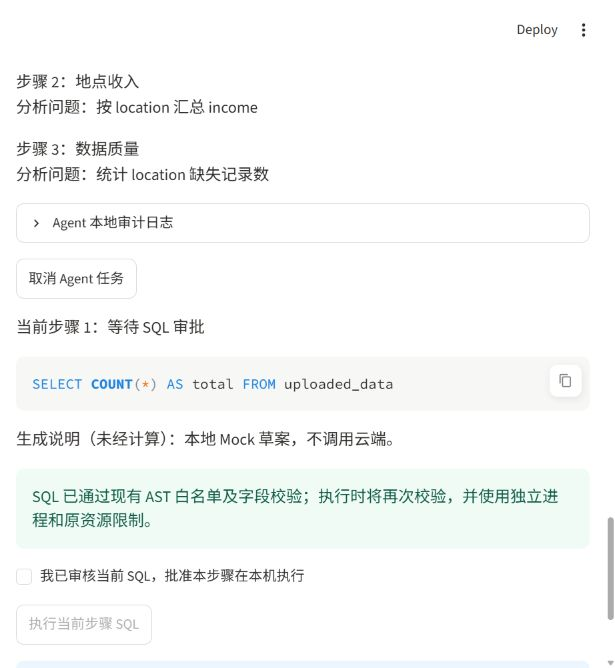
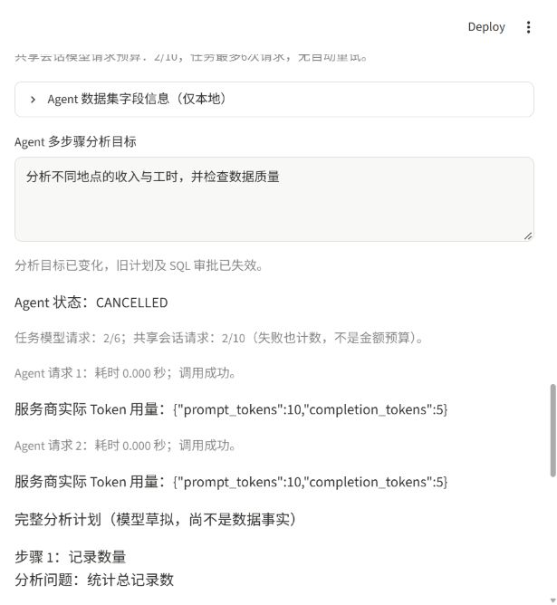

# DataPilot V4.0 Beta：受控多步骤分析页面

后续 V4.0.1 的审批加固和报告排版见 [V4.0.1验收说明](V4_0_1_ACCEPTANCE.md)。

最新的 SQL 提示兼容修复及安全 AST 节点审计见 [SQL AST 兼容说明](SQL_AST_COMPATIBILITY.md)。

本轮完成 Streamlit 页面、现有 DeepSeek Provider 接线和端到端 Mock 验收。
没有发起真实 DeepSeek 请求，没有修改 `.env`、SQL 白名单、Git 历史或计费设置，
没有执行 GitHub push。真实云端端到端验收等待用户另行确认。

## 使用方法

在项目根目录的 PowerShell 中启动：

```powershell
.\.venv\Scripts\python.exe -m streamlit run app.py
```

1. 上传 CSV/XLSX，选择工作表或 CSV 读取选项。
2. 在“AI Agent 多步骤分析”区域打开开关，检查本地字段、类型、行列数和缺失统计。
3. 填写分析目标，展开规划外发预览，确认字段结构和目标可以发送，再点击
   “生成 Agent 分析计划”。默认不发送原文件、完整表、数据行或样本。
4. 阅读全部一至三个步骤，点击“批准 Agent 完整计划”。不接受时取消任务。
5. 检查当前步骤 SQL 生成请求的精确预览，确认外发后点击“生成当前步骤 SQL”。
   不会发送前一步查询结果，只发送必要字段、类型、用户目标和已批准的步骤问题。
6. 查看 SQL、生成说明与安全检查提示，单独勾选审批，点击“执行当前步骤 SQL”。
   每个后续步骤重复生成与执行审批，没有自动循环执行。
7. 全部完成后查看本地事实报告、各步 SQL 和实际结果表、NULL 数量及截断提醒。
8. 可选报告需再次检查精确的结果数据预览，并单独确认外发，才点击生成报告。
   不需要云端报告时，本地事实报告已经可用。

未配置模型时，上传、数据预览和手动 SQL 继续可用。没有设置 API Key 的 Agent
不能规划任务，不会自动开通模型服务。页面不提供模型自由选择工具、任意 Python
执行、自动图表、报告导出或多 Agent 功能。

## 与单次自然语言 SQL 的区别

| 项目 | 原有 AI 自然语言分析 | Agent 多步骤分析 |
| --- | --- | --- |
| 目标 | 一个问题生成一条 SQL | 一个目标规划一至三个步骤 |
| 授权 | SQL 生成外发、执行、解释外发 | 规划外发、完整计划、逐条 SQL、报告外发 |
| 执行 | 用户点击执行 | 逐步骤点击执行，每次重新审批 |
| 结果 | 单条结果及可选解释 | 每步结果、本地事实报告及可选受限报告 |
| 预算 | 原有会话预算 | 共用同一个会话预算，另有任务六次上限 |

两种模式可分别使用，修改单次问题不会修改 Agent 目标。Agent 开关默认关闭，
不影响原有单次分析和手动 SQL 流程。模式切换不自动取消任务，也不触发请求。

## Provider、用量和隐私

继续使用 `LLMConfig.from_environment()` 读取现有本地 `.env`，系统环境变量优先。
默认配置为现有 DeepSeek 官方兼容端点；本轮没有更改配置项或另写 HTTP 客户端：

```dotenv
DATAPILOT_API_KEY=请在本地填写自己的密钥
DATAPILOT_BASE_URL=https://api.deepseek.com
DATAPILOT_MODEL=deepseek-flash
```

请使用服务商当前可用且有权限的模型标识，不要把真实密钥粘贴到源码、问题、截图
或工单。配置方法沿用 README；`.env` 不应进入版本控制。

真实 `OpenAICompatibleProvider` 仅在模型按钮事件期间创建，使用与单次功能相同的
超时、输出上限、JSON 模式、非思考设置、响应解析和 Token 统计。Agent 任务保留
不含配置和密钥的临时代理，实际 Provider 通过 `ContextVar` 在当前调用中绑定，
`finally` 中解绑，不把真实 Provider 或 `LLMConfig` 存入 `session_state`。

配置字段兼容修复：两个页面的任务指纹统一读取 dataclass 的实际字段
`token_parameter`，不再读取派生属性 `request_token_parameter`。该派生属性在当前
Provider 源码和新 Python 进程中确实存在，因此不能仅凭这次 traceback 确定旧进程
为何缺少它；旧进程模块版本或启动路径差异仍是待核实项。没有新增同名属性或
使用静默回退。Provider 的实际 Token 参数转换保持原样：官方 DeepSeek 使用
`max_tokens`，JSON 模式及非思考参数沿用原实现。更新代码后请停止旧 Streamlit
进程，从本项目虚拟环境重新启动，避免混用已加载模块。
本次修复验收：Agent 页面定向29项全部通过；全量 pytest 为168项通过、2项真实
API 测试跳过（另有153个通过的 subtest），耗时71.43秒。使用真实配置 dataclass
及 Mock Provider，HTTP 请求被测试断言阻断，没有调用真实 DeepSeek。

规划、SQL 生成和报告统一使用该路径；HTTP 400、401、403、404、429、500 等状态
沿用原有固定中文分类，连接、读取和网络超时保留安全类别。状态机只显示白名单
错误提示，不拼接原始响应、URL、密钥或请求正文。未知异常使用通用安全提示。

每个请求显示本地耗时、调用成功标志以及服务商实际返回的 Token 字段；缺失用量
不估算、不补造总量或费用。HTTP 成功但模型 JSON/SQL 校验失败时，调用统计仍可
显示调用成功，任务状态则是 FAILED，两者含义不同。失败请求也计数，无自动重试。

每任务最多六次请求，正常三步通常为规划一次、SQL 三次、可选报告一次，共四至
五次；共享现有会话 `ai_api_budget`，默认10次。额度耗尽不会发出新的请求。
如需重置会话计数，沿用单次 AI 区域的显式费用确认，Agent 失败任务仍须重新建。

报告包跨所有步骤合计最多20行、20列、8KB UTF-8，沿用单元格200字符上限。
Alpha 长表实际四列为“步骤、结果行、字段、值”，每行对应一个真实结果单元格，
不人为拼接 NULL；超过限额按部分结果处理，可能不覆盖后续步骤。用户确认的
`json_text` 与实际请求正文中的用户消息必须完全一致，不另加原始表、文件、目标
或 SQL。系统提示也沿用现有受限解释协议，不包含额外用户数据。

本地报告不收费、不外发；云端报告只允许核验后的单元格/数值极值引用以及受限
推断和建议模板，不是任意自由生成的长篇报告。页面明确分开数据事实、尚未证实
的模型推断、建议，并提示 NULL 不是零，截断结果不能代表全量。

## 状态、审批和幂等

复用 Alpha 的八种状态及明确转换，不另建执行引擎。`st.session_state` 保存
AgentRunner、数据集标识和 UI 版本号；渲染仅读取快照，按钮才发出服务层命令。
每个任务/步骤使用稳定命令标识，重复相同事件不会再次调用模型或执行 SQL。
新命令标识同样不能绕过状态检查。

每条 SQL 的审批标识绑定任务、步骤与 SQL；对应复选框也使用该标识作为 key。
计划批准不代替 SQL 审批，第一步复选框不能用于第二步。更改目标会取消并丢弃
旧任务，产生新的授权版本；即使把目标改回原文，旧复选框也不能复活。

数据集标识包含文件内容摘要、文件名摘要、工作表、编码和分隔符。上传移除、
读取失败或数据源变化时，在其他分析区域渲染前使旧 Agent 失效；即使关闭 Agent
区域也生效。模型端点、模型或协议选项变化后再次打开区域也须重新授权。

取消任务后只展示历史信息，不再提供后续执行入口。必须点击“新建 Agent 任务”
重新授权。普通 Streamlit rerun 保留状态；浏览器完整刷新或服务器重启可能创建
新会话，旧任务不会自动恢复或执行。审计仅本地内存，含时间、顺序、状态、步骤
和内容散列，不是持久化或防篡改日志；不要把包含数据的完整任务对象写入公开日志。

## Mock 自动化与浏览器验收

测试环境：Windows PowerShell、项目现有 Python 3.12 虚拟环境、Streamlit AppTest。
使用模拟配置、模拟 Provider，并将 requests HTTP 请求替换为失败断言。
正常三步端到端测试中的 SQL 实际经过原独立进程安全执行器，不只检查界面文字。

```powershell
Remove-Item Env:DATAPILOT_LIVE_API -ErrorAction SilentlyContinue
.\.venv\Scripts\python.exe -m unittest discover -s tests -p test_agent_ui.py -v
.\.venv\Scripts\python.exe -m unittest discover -s tests -v
```

新增页面测试覆盖用户要求的17类场景，以及上传移除/无效文件、文件名变化、目标
改回、模型配置变化、预览一致性和不在任务状态中保存密钥。原 Alpha 和 V3.1 测试
均纳入全量运行。真实 API 冒烟仍默认跳过，本轮没有开启。

最终全量结果：**168项，166项通过，2项真实 API 测试跳过**，耗时68.023秒。
其中原有141项保持139通过、2跳过，新增 Beta 页面测试27项全部通过。
最后的 SQL 超时分类和报告失败保留本地报告调整后，额外运行 Agent 测试56项
（Alpha 29项、Beta 27项），全部通过，耗时20.449秒。

可选本地浏览器 Mock 夹具（不会读取真实 `.env`、requests HTTP 已阻断）：

```powershell
.\.venv\Scripts\python.exe -m streamlit run tests/fixtures/agent_mock_app.py --server.address 127.0.0.1 --server.port 8766 --server.headless true --browser.gatherUsageStats false
```

访问 `http://127.0.0.1:8766`，已有纯虚构的三行数据，按上述流程操作；终端按
Ctrl+C 停止。夹具显示的 Token 为模拟值，不能作为真实用量。生产使用入口仍为
`app.py`，不得用夹具验收真实 API。

| 浏览器检查 | 本轮结果 |
| --- | --- |
| 开启区域、输入中文目标、规划确认 | 通过，Mock 返回三步计划 |
| 未审批 SQL 的执行按钮 | 禁用，截图留证 |
| 审批后执行第一步 | 通过，本地 COUNT 实际返回3 |
| 下一步审批隔离 | 通过，第二步请求确认未勾选，未自动请求 |
| 步骤间取消 | 通过，CANCELLED，仅保留重新授权新任务入口 |
| 取消后完整刷新、浏览器控制台 | 通过，新会话未恢复旧任务或执行入口，控制台未捕获 error |
| 三步完成与可选报告 | AppTest 通过；浏览器人工路径未重复全部步骤 |
| 移动端、屏幕阅读器、跨浏览器 | 尚未专项验收 |

截图只含虚构数据和 Mock 用量：





## 等待用户确认后的真实验收步骤

以下仅为操作说明，本轮没有执行：

1. 用户明确批准一次小规模真实 Agent 验收，并自行确认服务商费用、可用模型及
   本地 `.env`。不要发送或打印密钥。
2. 启动 `app.py`，上传 `examples/demo_income.csv` 纯虚构数据，打开 Agent 区域。
3. 输入“分析不同地点收入与工时，并检查缺失值”，检查精确请求，确认后只发出
   一次规划请求，记录耗时及服务商实际返回用量。
4. 审核完整计划，逐步生成 SQL 并单独批准执行；核对字段、口径、真实计算结果。
   遇到错误即停止，不反复点击或自动重试。
5. 检查本地报告。若明确同意结果外发，检查20行/20列/8KB包后再单独请求一次
   报告；否则跳过。正常三步合计四次，带报告五次请求。
6. 确认 rerun 没有增加请求或执行次数；新数据、修改目标或取消后旧审批不能使用。
   仅记录状态、耗时和实际 Token，不保存密钥、真实数据或原始错误正文。

## 已知边界

### 两步骤故障诊断与规划约束修复（2026-11-10）

已确认的代码缺陷是诊断信息被压平：原 Agent 将多类 `AIAnalysisError` 显示为同一
提示，原审计没有阶段或错误类别；Provider 对模型内容的 JSON 解码也曾返回通用
错误。另一个已确认缺陷是规划只校验一至三步，不核对目标中的明确两步要求。
仅凭“第一步成功、后续校验失败”无法认定本次真实请求用了 CASE、字段错误或
非法 JSON；本地审计仅在内存中，没有本次实际日志或失败 SQL 时无法追溯原响应。

新的失败卡片和 `command_failed` 审计事件记录：

| 字段 | 含义 |
| --- | --- |
| step | 当前 SQL 步骤编号；规划、计划审批或报告为不适用 |
| stage | 规划生成/JSON解析/步骤校验、SQL生成/安全校验/字段校验/执行、预算或状态校验 |
| category | 固定安全类别，不含原始异常或模型响应 |
| sql_submitted | 本步骤是否已提交现有安全执行器；不等于查询已经成功运行 |
| model_requests_consumed | 当前操作新增的模型请求尝试数，失败请求也消耗一次 |

以前某些成功事件按结果数加一标号，可能看起来属于下一步；现在审计使用当前
命令绑定的步骤。生成失败但第一步已经成功时，第二步应显示“未执行”，第一步
历史结果仍保留。执行器已提交但出错时，页面明确说“是否实际运行或完成未确认”，
不会把提交等同成功。预算已满而未发出请求时记录零次，不补造用量或费用。

主要类别：`PLANNING_JSON_INVALID`、`PLANNING_STEPS_INVALID`、
`PLAN_STEP_COUNT_MISMATCH`、`PLAN_NON_SQL_STEP`、`SQL_GENERATION_FORMAT`、
`SQL_AST_REJECTED`、`SQL_PARSE_ERROR`、`SQL_FIELD_ERROR`、`SQL_TABLE_ERROR`、
`SQL_EXECUTION_FAILED`、`SQL_EXECUTION_TIMEOUT`、`AGENT_STATE_TRANSITION`、
`SESSION_REQUEST_LIMIT` 和 `TASK_REQUEST_LIMIT`。HTTP 错误继续沿用固定分类。
未知错误仍使用通用安全类别，不从敏感正文猜测原因。

用户写明“两个SQL步骤”“分两步”“2个步骤”“two SQL steps”等明确数量时，
规划提示会说明数量，返回数量不符则**拒绝整份计划**，不截断、不自动重试、
不执行多余步骤。总体上限仍为三个。明显的“生成最终报告”步骤会被拒绝；最终
报告只在 SQL 完成后独立授权。数量检测和报告步骤检测只覆盖明确表达，不是完整
自然语言语义验证，其他措辞仍需人工审核完整计划。

现有白名单没有 `Case`、`If` 或 `Nullif` 节点，**CASE WHEN 和 NULLIF 均不支持**。
没有扩大 SQL 权限。按地点加权时薪仍使用现成 `src/evaluation.py` 的参考方案：

```sql
SELECT t.location, t.total_income, t.total_hours,
       ROUND(t.total_income / d.total_hours, 2) AS hourly_rate
FROM (
    SELECT location, SUM(income) AS total_income, SUM(hours) AS total_hours
    FROM uploaded_data GROUP BY location
) t
LEFT JOIN (
    SELECT location, SUM(hours) AS total_hours
    FROM uploaded_data GROUP BY location HAVING SUM(hours) <> 0
) d ON t.location = d.location OR (t.location IS NULL AND d.location IS NULL)
ORDER BY hourly_rate DESC, t.location
```

右侧不含零总工时组，所以左连接后的分母为 NULL；保留所有收入、零工时地点及
空地点，不用 `WHERE hours > 0` 改变口径。该方案仍须逐条人工审批，通过原有
字段校验、AST 白名单和独立进程后执行。Mock 回归实际比对四行结果及 NULL。

重新真实验收前应停止旧 Streamlit 进程，从项目虚拟环境启动并**新建任务**，
旧任务没有的新诊断不能事后恢复。建议明确两步目标：“只用两个 SQL 步骤：
第一步按地点汇总收入及工时；第二步计算加权时薪，零总工时返回 NULL。”
先核对精确规划请求和完整两步计划，再逐条生成、审批、执行；任一步失败即停止，
只记录新诊断卡片和审计的安全类别，不公开密钥、原始响应或真实数据。
本轮没有执行真实 API 验收，仍须用户另行确认。

本次诊断修复验收：全量 pytest **183项通过、2项真实 API 测试跳过**，另有167个
通过的 subtest，耗时71.12秒。新增15项测试，包括11项诊断服务测试、3项页面
回归和1项 Provider JSON 类别测试。Agent 页面32项在全量及独立运行中全部通过。

### 其他安全边界

- 模型的计划与 SQL 可能语义不正确，尤其平均值、时薪分母和业务口径；通过语法
  校验不代表业务正确，完整计划和 SQL 仍需人工审核。
- 请求运行时为同步处理，取消不能保证立即中断在途 HTTP/SQL；模型请求可能
  已计费，SQL 仍由原超时与进程回收约束。取消检查阻止后续步骤和结果提交。
- `session_state` 仅保存在本地进程内存，深拷贝数据及结果会额外占用内存；不提供
  跨服务器恢复、用户认证、任务持久化或全进程内存硬限制。
- Alpha 的受限事实引用不会任意编造数值，但无法保证完整分析目标都被覆盖；
  部分结果尤其可能省略后面的步骤。事实列表仍需结合对应预览出处阅读。
- 这不是完全隔离环境，也不能声称完全防止提示词注入。可信应用负责授权，
  原有 SQLGlot 白名单、字段校验、DuckDB 安全配置及进程限制继续共同约束执行。
- 没有新增大型框架、工具自动发现、无限重试、图表、导出、Ollama 或多 Agent。
